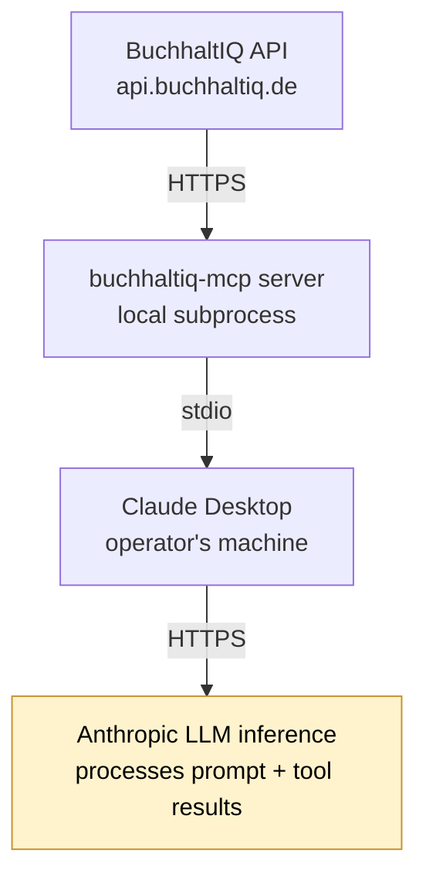

# Privacy & Data Handling

This document explains what data `buchhaltiq-mcp` processes, where it flows, and what compliance obligations apply when it is deployed against a real BuchhaltIQ workspace.

> **Not legal advice.** This is an engineering-level overview intended to help operators, integrators, and reviewers understand the data architecture. Operators should engage their own data-protection officer (DSB) and legal counsel before activating production mode.

---

## TL;DR

- **Demo mode (default).** No personal data is processed. All fixture content is fictional, clearly labeled `(Demo)`, and uses [RFC 2606](https://datatracker.ietf.org/doc/html/rfc2606) reserved e-mail domains. The repository, its CI, and public demos using demo mode are outside the scope of GDPR.
- **Production mode.** Real BuchhaltIQ workspace data flows through Claude Desktop to Anthropic's API for inference. This is a personal-data processing activity under GDPR (DSGVO) and requires the deploying party to have appropriate agreements and disclosures in place. Production mode is currently a stub — calling any tool raises a clear error pointing back to demo mode until the integration is wired up.
- **The server itself does not phone home.** No analytics, no telemetry, no remote logging. The only outbound network call (in production mode) targets `api.buchhaltiq.de`.

---

## Two modes, two data stories

### Demo mode — `BUCHHALTIQ_MCP_MODE=demo` (default)

The server reads only from local JSON fixtures under [`data/`](../data/):

| File | Contents |
|---|---|
| `customers.json` | Five fictional German SMBs, each with `(Demo)` in the name. Contact addresses use the IANA-reserved `.example` TLD and can never resolve to a real mailbox. |
| `invoices.json` | Eight invoices referencing the demo customers. Free-text descriptions are generic (e.g. "Catering Frühlingsfest", "Beratungsleistung Q1"). |
| `belege.json` | Six receipts with vendor names that are public legal entities (METRO, Telekom, Shell, OBI, DATEV, Deutsche Post). Per GDPR Art. 4(1), juristische Personen are not data subjects. |

In demo mode, **no personal data of natural persons is processed.**

### Production mode — `BUCHHALTIQ_MCP_MODE=production`

When wired up (currently stubbed), the server will proxy BuchhaltIQ workspace data to whichever MCP client launched it.

Three handoffs matter:

1. **BuchhaltIQ → MCP server.** Local HTTPS call authenticated with the operator's `BUCHHALTIQ_API_KEY`. Same data category as any other authorized API client.
2. **MCP server → Claude Desktop.** Local `stdio` between two processes on the operator's machine. Data does not leave the device on this hop.
3. **Claude Desktop → Anthropic.** Whatever the LLM needs to answer the user's question (invoice rows, customer details, receipt text, etc.) is included in the prompt and processed on Anthropic's infrastructure. **This is the GDPR-relevant data export.**

---

## Compliance considerations (GDPR / DSGVO)

When production mode is enabled, the deploying organization is processing personal data of its own customers and bears the legal responsibility. The following obligations should be addressed **before** any production rollout. The list is non-exhaustive — treat it as a starting point for a proper DPO review, not a checklist that satisfies the regulator on its own.

| Obligation | Article | Owner | Notes |
|---|---|---|---|
| Data Processing Agreement with Anthropic | Art. 28 | Operator | Anthropic publishes a DPA covering Claude API processing. Must be signed before production use. |
| Third-country transfer safeguards | Art. 44 ff. | Operator | Verify whether the chosen Claude API endpoint offers EU data residency. If not, Standard Contractual Clauses plus a documented Transfer Impact Assessment are required. |
| Privacy notice / information duty | Art. 13 | Operator | The operator's privacy policy must disclose that activating the Claude integration transmits invoice and customer data to Anthropic. |
| Lawful basis for processing | Art. 6 | Operator | Typically legitimate interest or explicit consent. Document the chosen basis. |
| Records of processing activities | Art. 30 | Operator | The new processing activity belongs in the operator's RoPA. |
| Data Protection Impact Assessment | Art. 35 | Operator | Likely required for automated processing of accounting data at scale. |
| Opt-in, not opt-out | Art. 7 | Operator | The integration must be off by default and require an active user choice. |
| No model training on customer data | DPA / Art. 28 | Operator | Anthropic's commercial terms exclude API content from model training by default; confirm in the signed DPA. |
| Joint controllership analysis | Art. 26 | Operator + Integrator | If both BuchhaltIQ and the deploying customer determine purposes/means of processing, a joint-controller arrangement may be needed. |

Operators in regulated contexts (Steuerberater, Wirtschaftsprüfer) additionally need to consider §§ 203 StGB and § 102 AO regarding professional secrecy before transmitting client data to a third-party AI service.

---

## What this server does NOT do

- **No telemetry.** No analytics SDK, no usage pings, no remote crash reporting. The dependency tree (`mcp`, `pydantic`, `httpx`) contains no client that emits data to the maintainers or any third party.
- **No persistent logging of tool payloads.** Inputs and outputs flow only over `stdio` between the server and the launching MCP client. Server-side debug logs go to `stderr`, are not retained on disk by default, and never include API responses.
- **No state between requests.** Demo fixtures are loaded with `lru_cache`; no per-call data is written anywhere.
- **No end-user accounts.** The server has no notion of identity of its own. The only credential it consumes is the operator's `BUCHHALTIQ_API_KEY` (production mode).

---

## For contributors and reviewers

If you are cloning this repo to develop, file an issue, or evaluate the architecture:

- The fixture data under [`data/`](../data/) is fictional and safe to redistribute, screenshot, or quote.
- **Do not** paste real customer data into issues, pull requests, or commit messages. Use the existing demo IDs (`cust_001`, `inv_2026_0001`, …) when reporting a bug.
- Local secrets (`.env`, API keys) are gitignored. Please do not relax those rules.
- The internal handover document under `private/` is gitignored and must remain so.

---

## Reporting a privacy concern

If you believe this server mishandles data — actual or potential — please disclose responsibly rather than opening a public issue:

- Reach out via [Born — Theoretical Software](https://bornsoftware.de) using the contact route on the website.
- Use the subject prefix `[buchhaltiq-mcp privacy]`.

We aim to acknowledge within five business days.

---

## Disclaimer

This document describes the data architecture of `buchhaltiq-mcp` as of the current commit. It is not legal advice and not a substitute for a qualified DPO review or contractual due diligence. Statements about third-party processors (notably Anthropic) reflect their published commercial terms at the time of writing; verify them yourself before relying on them in a deployment.
