# Target Architecture

What a production-grade, multi-tenant, GDPR-compliant deployment of `buchhaltiq-mcp` looks like — and the migration path from where we are today.

## TL;DR

**The "perfect" architecture has five layers.** The current developer-mode build implements layer 4 (tool surface) most completely; the four other layers are partially scaffolded with documented migration paths. **Most of what's missing is paperwork** (AVV, DSFA, opt-in flow) **and one new auth flow** (refresh tokens or MCP OAuth) **— not fundamental code rewrites.** The tool surface itself needs three additions: OCR pipeline, UStVA generator, reverse-charge detection.

```mermaid
flowchart TB
    subgraph identity["1 — Identity & Auth"]
        A1[Firebase ID Token<br/>1h, in config file] -.->|migration| A2[Refresh-Token flow<br/>OR MCP OAuth]
    end
    subgraph tenant["2 — Tenant Isolation"]
        T1[1 Firebase UID =<br/>1 workspace] -.->|migration| T2[Custom claims +<br/>on_behalf_of API +<br/>audit log]
    end
    subgraph privacy["3 — Privacy & Compliance"]
        P1[Demo-mode safe<br/>Production needs AVV] -.->|migration| P2[AVV signed +<br/>opt-in + DSFA +<br/>field minimization]
    end
    subgraph tools["4 — Tool Surface"]
        S1[11 tools:<br/>read, math, Kontierung] -.->|migration| S2[+ OCR + UStVA<br/>+ §13b + GoBD checks]
    end
    subgraph ops["5 — Operability"]
        O1[stdio, no metrics,<br/>no rate limit] -.->|migration| O2[Logs + metrics +<br/>rate limit + versioning]
    end

    style A2 fill:#fff3cd,stroke:#c4922e,color:#000
    style T2 fill:#fff3cd,stroke:#c4922e,color:#000
    style P2 fill:#fff3cd,stroke:#c4922e,color:#000
    style S2 fill:#fff3cd,stroke:#c4922e,color:#000
    style O2 fill:#fff3cd,stroke:#c4922e,color:#000
```

---

## Layer 1 — Identity & Authentication

| Today | Target |
|---|---|
| Firebase ID token in `claude_desktop_config.json` (env var) | Auto-refreshed token, never persisted in cleartext |
| 1h token lifetime, manual replacement | Refresh-token flow OR MCP OAuth (when standard finalises) |
| No "log out" — user deletes the token from the file | Native logout / disconnect from BuchhaltIQ-side |
| No idea who's using the integration if the token is shared | Token bound to device + user, revocable per-device |

**Migration path**

1. **Refresh-token flow** (1-2 days): MCP server stores a long-lived refresh token, calls a new backend endpoint `POST /api/auth/refresh-id-token` whenever the current ID token has <5 min left. User pastes the refresh token once, never again. Refresh tokens are revocable from the BuchhaltIQ user-settings panel.
2. **OS keychain integration** (1 day): instead of plain JSON, secrets live in macOS Keychain / Linux Secret Service. The MCP server reads from there at startup.
3. **MCP OAuth** (when Anthropic finalises the spec): replaces both above with a browser-based login flow Claude Desktop initiates.

---

## Layer 2 — Tenant Isolation

| Today | Target |
|---|---|
| `users/{uid}/...` Firestore scope; one UID = one workspace | Custom Firebase claims declare which UIDs a Steuerberater may impersonate |
| No way for a tax advisor to see a client's books | Explicit `?on_behalf_of=client_uid` API parameter; backend checks delegation claim |
| No record of who accessed what | Per-call audit log: caller-uid, target-uid, tool, params, timestamp |
| No revocation UX | Client can revoke a tax advisor's delegation from the BuchhaltIQ app |

**Migration path**

1. **Custom claims schema** (~½ day backend): `{ "delegations": ["client-uid-1", "client-uid-2"] }` set by an admin endpoint when a client authorises an advisor.
2. **Permission middleware** (~1 day backend): every uid-scoped route accepts `?on_behalf_of=...`; verifies the caller has the corresponding delegation claim before scoping the Firestore query.
3. **Audit-log collection** (~½ day backend): write to `audit_log/{date}/{call_id}` on every tool invocation; never deleted by the application.
4. **MCP-side plumbing** (~½ day MCP): tools accept an optional `on_behalf_of` parameter that the LLM passes through.
5. **Frontend UX** (~2-3 days BuchhaltIQ-app): "share my data with my Steuerberater" toggle, with revoke button and audit-log viewer.

---

## Layer 3 — Privacy & Compliance

| Today | Target |
|---|---|
| Demo-mode safe (RFC-2606 fixtures, no PII) | Same |
| Production-mode requires AVV not yet signed | AVV signed with Anthropic |
| No DSFA done | DSFA done, documented |
| No opt-in flow | Active user consent before any data leaves the workspace |
| Tools return whole records (incl. IBANs, StNr) | Field-level minimization — sensitive fields only on explicit request |
| No data residency configuration | EU residency confirmed in DPA + verified in tool calls |
| § 203 StGB (Berufsgeheimnis Steuerberater) not addressed | Berufsrechtliche Freistellung im Mandantenvertrag dokumentiert |

**Migration path**

1. **Sign Anthropic DPA** (~1 day, mostly waiting on signatures).
2. **DSFA durchführen** (~1 week with DSB) — document risks, mitigations, residual risk.
3. **Opt-in flow** (~½ day frontend): toggle in BuchhaltIQ-app settings, default off, with explainer text.
4. **Field minimization** (~1 day MCP): each read tool returns a minimal projection by default; sensitive fields require `include_sensitive=True`. The LLM only includes that flag when the user explicitly asks.
5. **Update `docs/PRIVACY.md`** to reflect signed agreements + residency choice.
6. **For Steuerberater path**: Mustervereinbarung addressing § 203 StGB (template for tax advisors to sign with their clients before activating Claude integration).

---

## Layer 4 — Tool Surface

| Today (11 tools) | Target additions |
|---|---|
| `list_invoices`, `get_customer`, `search_belege`, `monthly_report`, `categorize_transaction`, `extract_vat_from_receipt`, `map_tax_rate_to_bu_key`, `validate_datev_account`, `apply_bewirtung_rule`, `split_mixed_tax_receipt`, `resolve_account_assignment` | `analyze_receipt_positions` (receipt-photo parsing — vision-model TBD) |
| | `extract_creditor_data` (vendor master from receipt photo) |
| | `generate_ustva` (monthly Umsatzsteuer-Voranmeldung) |
| | `detect_reverse_charge` (auto-flag §13b for EU services) |
| | `validate_gobd` (duplicate detection, integrity hash for archived receipts) |
| | `compare_periods` (Q1 vs Q2, year-over-year) |
| | `forecast_cashflow` (based on open invoices + recurring patterns) |

**Migration path**

For each new tool: same seven-step pattern from [`architecture.md`](architecture.md). None of these backend services exist yet — receipt-photo parsing, UStVA generation, reverse-charge detection, GoBD compliance checks all need to be designed and built in BuchhaltIQ before MCP wrapping. The choice between Claude Vision, a self-hosted vision model, or a structured-OCR provider for receipt-photo parsing is itself an open architecture decision.

**Priority order**

1. OCR pipeline first — closes the most painful end-user loop (Beleg-Foto → automatische Verbuchung).
2. UStVA generator — high-value monthly task automation.
3. Reverse-charge detection — relevant for any business with EU vendors (most consultants, software shops).
4. GoBD checks — important for audit defensibility but lower daily-use value.
5. Period comparisons + forecast — analytical surface, valuable but not blocking.

---

## Layer 5 — Operability

| Today | Target |
|---|---|
| `stdio` transport, no telemetry | Structured logs (JSON-line), per-tool latency + success metrics |
| No rate limiting | Per-tenant rate limits at the backend (e.g. 60 req/min) |
| No versioning beyond Git tags | Semantic versioning of MCP tool surface; tools opt into a version |
| Manual install / update | Auto-update via a launcher (or via Homebrew formula) |
| No health probe | `GET /api/health` for backend; MCP server exposes `version` info on stdio init |
| No alerting | Backend errors surface in Born's existing observability stack |

**Migration path**

1. **Structured logging** (~½ day): JSON-formatted logs from MCP server to stderr; backend already has logging.
2. **Metrics** (~1 day): per-tool latency / error rate exposed by the backend; collected by Born's existing tools.
3. **Rate limiting** (~½ day backend): per-uid token bucket on the four data-read endpoints.
4. **Tool versioning** (~½ day MCP): each tool's docstring + return-shape carries an `MCP_TOOL_VERSION` constant; LLM clients can negotiate.
5. **Distribution** (~2-3 days): Homebrew formula or a small launcher binary that handles `pip install --upgrade` automatically.

---

## Phased Roadmap

### Phase A — Single-User Productive *(1 week)*
- Refresh-token flow (Layer 1)
- Demo-name verification + public switch (Layer 3 hygiene)
- Self-test for 1-2 weeks against own restaurant data
- **Outcome:** the developer uses Claude over BuchhaltIQ daily, without re-pasting tokens every hour

### Phase B — Showcase Public *(1-2 weeks, parallel to A)*
- Demo video, case study, README polish — **already done**
- Public GitHub
- MCP-Server-Index PR on `modelcontextprotocol.io`
- **Outcome:** Anthropic application has a portfolio piece a reviewer can verify in 5 minutes

### Phase C — Two-User Beta *(1 month)*
- AVV signed (Layer 3)
- Opt-in toggle in BuchhaltIQ frontend (Layer 3)
- Audit log live (Layer 2 partial)
- Field minimization (Layer 3)
- One friendly customer onboards
- **Outcome:** real two-tenant validation, real DSGVO posture

### Phase D — Steuerberater Multi-Mandant *(3 months)*
- Custom claims (Layer 2)
- `on_behalf_of` plumbing (Layer 2)
- Mandanten-UX in frontend
- § 203 StGB Mustervereinbarung
- DSFA done (Layer 3)
- **Outcome:** a tax advisor with 10 clients can drive all 10 books from one Claude conversation

### Phase E — Productised *(6 months)*
- One-click setup from BuchhaltIQ-app (Layer 1 finalised)
- OCR pipeline live (Layer 4)
- UStVA generator (Layer 4)
- Auto-update + Homebrew (Layer 5)
- **Outcome:** the Bäckerin can install + use it without ever touching JSON

---

## What we have vs. what's missing

| Capability | Today | Phase A | Phase C | Phase E |
|---|:---:|:---:|:---:|:---:|
| 11 tools production-wired | ✅ | ✅ | ✅ | ✅ |
| Decimal precision, audit trails | ✅ | ✅ | ✅ | ✅ |
| Demo-mode reproducible | ✅ | ✅ | ✅ | ✅ |
| GDPR-safe public repo | ✅ | ✅ | ✅ | ✅ |
| Auto-refreshing tokens | ❌ | ✅ | ✅ | ✅ |
| AVV signed | ❌ | ❌ | ✅ | ✅ |
| Opt-in flow in app | ❌ | ❌ | ✅ | ✅ |
| Field minimization | ❌ | ❌ | ✅ | ✅ |
| Audit log per call | ❌ | ❌ | ✅ | ✅ |
| Tax-advisor multi-mandant | ❌ | ❌ | ❌ | ✅ |
| OCR pipeline | ❌ | ❌ | ❌ | ✅ |
| UStVA generator | ❌ | ❌ | ❌ | ✅ |
| One-click setup | ❌ | ❌ | ❌ | ✅ |
| Auto-update | ❌ | ❌ | ❌ | ✅ |

---

## Risks & Open Questions

- **MCP OAuth standard timing.** Anthropic is actively designing it. If we adopt early, we're ahead; if we wait, Phase A's refresh-token flow becomes throwaway. Compromise: build the refresh-token flow with a clean abstraction so swapping for OAuth later is a one-day refactor.
- **§ 203 StGB Mustervereinbarung.** Berufsrechtlich tricky for tax advisors. Needs DSB + specialist Anwalt. Not blocking single-user (Phase A/C), blocking Phase D.
- **Mandanten-Trennung in BuchhaltIQ.** Significant frontend work. The MCP side is straightforward; the question is whether BuchhaltIQ-the-app supports the multi-mandant model in the first place.
- **DSFA cost & timeline.** Conservatively a week with a DSB. May surface mitigations we haven't thought of.
- **Anthropic data residency.** Need to verify EU residency is available for our usage tier when Phase C lands.

---

## What this is *not*

- A replacement for the existing BuchhaltIQ frontend. Most users will keep using the app.
- A real-time chat experience with the LLM running on every keystroke. MCP is request-response.
- A general-purpose accounting library. The tool set is opinionated for German SMB + DATEV-export.
