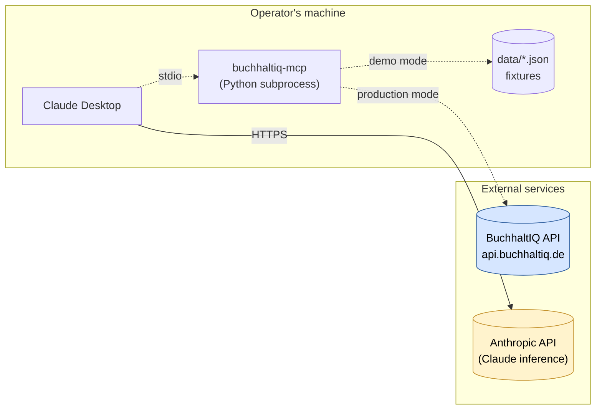

# Architecture

This document explains how `buchhaltiq-mcp` is wired together — for the developer who is about to add a tool, and for the reviewer who wants to verify the design before depending on it.

The companion documents are:

- [`PRIVACY.md`](PRIVACY.md) — what data flows where, and what GDPR / DSGVO obligations apply.
- [`tools-reference.md`](tools-reference.md) — exhaustive parameter and response reference for every tool.
- [`../examples/workflows/`](../examples/workflows/) — end-to-end Claude conversations using the tools.

---

## High-level picture



**Three things to internalize from the diagram:**

1. The MCP server is a **local subprocess** of Claude Desktop, communicating over `stdio`. It is not a hosted service. Every operator runs their own.
2. The server has **two distinct data paths** — fixtures in demo mode (the dotted line on the left), the BuchhaltIQ API in production mode (the dotted line on the right). The two paths never meet at runtime.
3. The transit to Anthropic happens entirely between **Claude Desktop and the Anthropic API** — the MCP server itself never talks to Anthropic.

---

## Components

### `config.py` — the mode switch

A frozen dataclass resolved once at startup from environment variables:

```python
Config(
    mode: Mode,                      # Mode.DEMO or Mode.PRODUCTION
    api_key: str | None,             # required iff mode == PRODUCTION
    api_base_url: str,
)
```

The mode is the single decision that flips the server between fixtures and a live API. It is parsed at startup and passed down by reference into every tool registration — tools never read environment variables themselves. This keeps tools pure and trivially testable: the same registration function is called once with `Mode.DEMO` and once with `Mode.PRODUCTION` in the test suite, and both branches are exercised on every CI run.

### `server.py` and `__main__.py` — the entry point

`build_server(config)` is a factory that returns a configured `FastMCP` instance. `__main__` calls the factory with `Config.from_env()` and runs the server over the standard MCP `stdio` transport, which is what Claude Desktop launches.

There is intentionally no second transport (HTTP, SSE, WebSocket). MCP Desktop integration is `stdio`-only today; adding more transports is YAGNI and would expose an attack surface that we don't otherwise need.

### `models.py` — the domain

Pydantic v2 `BaseModel`s with `extra="forbid"` so unexpected fields are caught at deserialization. `StrEnum` is preferred over the older `class X(str, Enum)` pattern because Python 3.11 made it canonical and Pydantic handles it natively. Every monetary field is `Decimal`, deserialized from JSON strings to avoid the float-precision pitfalls common in accounting software.

### `fixtures.py` — the demo data path

`load_customers()`, `load_invoices()`, `load_belege()` each return a list of validated model instances, cached with `lru_cache` so repeated calls within a process don't re-read or re-validate the JSON. The loader looks first in the repo's `data/` directory (for source checkouts) and then inside the installed wheel (for `pip install`-style usage).

### `tools/*.py` — the per-domain tool modules

Each domain (`invoices`, `customers`, `belege`, `reports`, `categorize`) has its own module with a single public entry point:

```python
def register(server: FastMCP, config: Config) -> None: ...
```

Inside `register`, the actual `@server.tool()` definitions are nested closures over `config`. The closure pattern means every tool sees the same Config without it appearing in the public signature — the LLM-facing parameter list stays focused on domain inputs.

`tools/__init__.py` exposes one helper, `register_all(server, config)`, which is the only thing `server.py` needs to import. Adding a new tool module is a one-line edit there.

### `exceptions.py` — the error vocabulary

Three exception classes, each surfaced through MCP's tool-error envelope so the LLM sees a structured failure rather than a Python traceback:

| Exception | Raised by | Meaning to the LLM |
|---|---|---|
| `BuchhaltIQError` | base class | Domain failure rather than a programming bug. |
| `NotFoundError` | `get_customer`, etc. | The requested resource does not exist; the LLM should ask for a different ID. |
| `ProductionNotImplementedError` | every tool's prod path | Production mode isn't wired up yet; the LLM should suggest demo mode. |

`ValueError` is used directly for input-validation failures (empty queries, out-of-range months) — it travels through MCP's exception handling unchanged and the LLM gets a readable message.

---

## The two-mode pattern

Every tool follows the same skeleton:

```python
@server.tool()
async def some_tool(...) -> ...:
    """Docstring becomes the tool description seen by the LLM."""
    # 1. Validate inputs (ValueError on bad input).
    # 2. Branch on mode.
    if config.mode is Mode.DEMO:
        return _demo_implementation(...)
    raise ProductionNotImplementedError(
        "<tool> is not yet wired to the production BuchhaltIQ API. "
        "Set BUCHHALTIQ_MCP_MODE=demo to use fixture data."
    )
```

The point of this skeleton is that **demo and production never share branches**. There is no shared post-processing step that runs in both modes; the demo path computes its result entirely from fixtures, and the production path will compute its result entirely from API responses. This keeps each path trivially auditable and prevents demo behavior from leaking into production answers.

When the production wiring lands (Phase 2), each tool gains a single new branch:

```python
if config.mode is Mode.PRODUCTION:
    return await _production_implementation(client, ...)
```

…where `client` is a shared `httpx.AsyncClient` instance carried on `Config` or a module-level singleton. The decision between `httpx.AsyncClient` and `mcp`-supplied transport is intentionally deferred until we have the first real endpoint to integrate against.

---

## Adding a new tool — the seven-step pattern

The recipe is identical for every domain. To add `cancel_invoice` (hypothetical):

1. **Domain model.** Extend `models.py` if a new entity is involved. Otherwise reuse existing models.
2. **Fixture data.** If the new tool reads data, add or extend a JSON file under `data/` with realistic German content. Cross-reference existing IDs (e.g. invoice IDs stay `inv_2026_…`) so multi-tool workflows compose.
3. **Loader.** If a new fixture file appears, add a corresponding `@lru_cache`'d loader to `fixtures.py`.
4. **Tool module.** Create or extend a domain module under `tools/`, exporting a `register(server, config)` function. Inside, define the tool with `@server.tool()`. Crucially, write the docstring as if explaining the tool to a smart but ignorant assistant — first line is what it does, then `Args:`, `Returns:`, `Raises:`. The docstring **is** the LLM-facing description.
5. **Registration.** Add the new module to `tools/__init__.py`'s import list and `register_all` body.
6. **Tests.** Add `tests/test_tools_<domain>.py`. Mirror the existing `_call_<tool>` helper so the tests look similar to the others and the assertion noise is minimal. Cover at least: happy path, validation error, production stub. For domain-specific edge cases, add more.
7. **README.** Move the new tool from "Planned" to "Currently implemented" in the Status section. Add a one-liner under the project-structure tree.

Each tool ships in **one commit** following [Conventional Commits](https://www.conventionalcommits.org/) (`feat(<domain>): …`) so reviewers can understand the change without reading code.

---

## Testing approach

Tests run against the public `FastMCP` API, not against the inner functions. Each test:

1. Builds a fresh `FastMCP` instance.
2. Calls the tool's `register(server, config)` with either a demo or production `Config`.
3. Invokes the tool through `server.call_tool(...)` — the same code path Claude Desktop uses at runtime.
4. Unwraps the response (which can be either structured or text-block, depending on FastMCP version) via a small helper.

This means a test covers not just the demo logic but the entire tool registration, schema generation, parameter coercion, and exception envelope. If the test passes, an end-user calling that tool from Claude Desktop will hit the same code path.

`pytest-asyncio` is configured with `asyncio_mode = "auto"` so individual tests don't need `@pytest.mark.asyncio`. Tests parameterize across vendors / months / IDs where useful (see `test_tools_categorize.py`'s vendor matrix), so adding a new rule or fixture row reduces to a one-line addition.

CI runs the full test suite plus `ruff check` and `ruff format --check` on Python 3.11, 3.12, and 3.13.

---

## What's intentionally absent

- **No telemetry.** The dependency tree (`mcp`, `pydantic`, `httpx`) contains nothing that emits usage data.
- **No persistence layer.** Every tool call is stateless. There is no DB, no cache layer, no per-user store. The `lru_cache` on fixture loaders is process-local and read-only.
- **No authentication on the server itself.** The MCP server doesn't have a notion of a user; it inherits the trust boundary of whoever launched it. In production mode, the BuchhaltIQ API key is the only credential, and it belongs to the operator.
- **No retry / circuit-breaker logic.** When the BuchhaltIQ client lands, retries on idempotent reads will be added at the `httpx` layer, not in tool code. Tool code stays thin.
- **No streaming.** Tools return complete results. MCP supports streaming responses but none of our tools today produce results large enough to justify the complexity.

These aren't omissions; they're decisions. Each one is a thing we'd add if we needed it, and none of them are needed yet.
